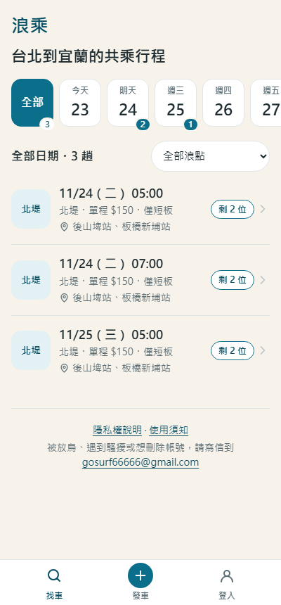
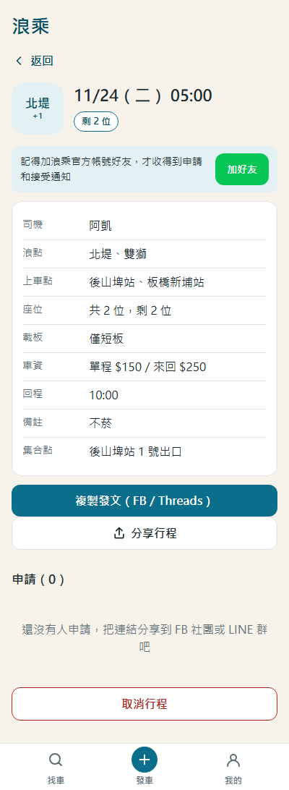
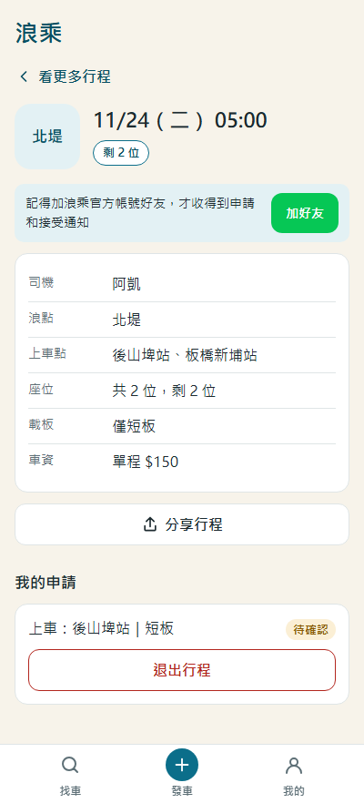

# 浪乘 Surfpool

**繁體中文** | [English](README.en.md)

**給台北到宜蘭衝浪的人用的共乘平台。** 司機用固定欄位發行程，乘客篩選、申請座位，雙方透過 LINE 推播即時知道結果。手機優先的網頁，介面全中文。

線上版：<https://surfpool-langcheng.fly.dev>

| 找車 | 司機的行程頁 | 乘客的申請 |
|:---:|:---:|:---:|
|  |  |  |

---

## 要解決的問題

北部浪友現在都在 Facebook 社團找共乘：自由格式的貼文，再一個一個私訊問。我整理了 **103 篇真實貼文（2026/8/30–11/5）**作為基準：

- **67%** 的司機貼文沒寫能不能載浪板，**45%** 沒寫有幾個座位。
- 從發文到出發的中位數只有 **18.7 小時**，**52%** 的行程在週末。多數行程前一天才發、清晨出發，回覆慢一點就錯過了。
- 貼文很快被洗掉，也沒辦法篩選。

原始追蹤表含真實姓名，所以只留在 repo 外。

## 浪乘做了什麼

- **司機**用必填欄位發行程：日期、浪點、上車點、座位數、載板條件、車資。第二次發行程會自動帶入上次的內容。
- **乘客**不用登入就能瀏覽行程、依日期篩選，再申請座位。不符合載板條件的申請，送出前就會被擋下。
- **司機**接受或拒絕申請，每一步雙方都會收到 **LINE 推播**。
- **申請被接受前，聯絡方式不公開。** 司機可以填精確的集合點（例如「3 號出口全家門口，白色 RAV4」），只有被接受的乘客看得到。
- 司機可以一鍵複製寫好的貼文，把行程連結分享回 FB 社團或 LINE。

成功指標：**每週成行趟數**（`npm run stats`），計算已出發、沒被取消、且至少有一位乘客被接受的行程。

## 目前進度

| | |
|---|---|
| MVP | 已完成並合併（[#1](../../issues/1) 規格 → [#2](../../pull/2)）。LINE 登入與 LINE 推播已在本機用真實帳號完整測過 |
| 已合併的 PR | 11 個（[#2](../../pull/2)–[#7](../../pull/7)、[#9](../../pull/9)、[#11](../../pull/11)–[#13](../../pull/13)、[#19](../../pull/19)） |
| 上線準備 | 隱私權說明、登入時同意的使用須知、客服信箱、加好友提醒、管理員刪除帳號都已完成（[#15](../../issues/15)–[#18](../../issues/18)，於 [#19](../../pull/19) 合併） |
| 自動化 UAT | 無頭瀏覽器實際點擊，58 個案例：**54 通過、4 部分通過、0 失敗**。4 個部分通過的案例需要用真手機確認 LINE 推播。[含截圖的報告](docs/uat/report-2026-11-23-run-A.md) |
| 部署 | **已上線**：<https://surfpool-langcheng.fly.dev>（Fly.io 東京，單機 + SQLite volume）。見 [`docs/deploy-fly.md`](docs/deploy-fly.md) |
| 使用者驗證 | **尚未完成。** 浪友願不願意離開 FB 社團、實際媒合率多少，還需要上線數據或訪談來回答 |

## 接下來

- [#10](../../issues/10) **開放給陌生人之前：** 隱私權說明、使用須知、客服信箱、加好友提醒、刪除帳號都已完成（[#15](../../issues/15)–[#18](../../issues/18)），還差用真手機與真實 LINE 帳號檢查一次。
- [#8](../../issues/8) **降低司機的麻煩：** 自動帶入、精確集合點、複製 FB 貼文都已合併；LINE 分享流程還要在真手機上跑過一次才能關閉這個 issue。
- 真實 LINE 測試（[`docs/uat-cases.md`](docs/uat-cases.md) 的 B/C 跑法）：在真手機上測推播、登入與分享。
- 在冬季浪況前，讓線上版跑出第一批真實行程。

上線準備計畫：[`docs/launch-readiness-plan.md`](docs/launch-readiness-plan.md) · 完整 UAT 案例：[`docs/uat-cases.md`](docs/uat-cases.md)

## 怎麼做的

這個版本用**規格驅動開發（SDD）**完成：先用貼文數據確認問題，把需求寫成規格（[Issue #1](../../issues/1)），重要的技術選擇寫成架構決策紀錄（[ADR](docs/adr/)），最後才讓 AI 依規格寫程式，每個功能都經過 PR 合併。

## 技術

- **零第三方套件。** 只用 Node 22 內建模組：`node:http`、`node:sqlite`、`node:test`。前端是 `public/` 裡的純 HTML/CSS/JS，不需要 build。clone 下來就能跑，不用安裝任何東西，也沒有套件漏洞要 `npm audit`。取捨見 [ADR 0001](docs/adr/0001-zero-dependency-node.md)。
- 單一 SQLite 檔案；寫入在同一個 process 內同步執行，所以座位不會超賣。
- 登入用 LINE Login，推播用 LINE Messaging API。

```
src/      伺服器、路由、服務邏輯、LINE client、統計
public/   手機版網頁前端
test/     node:test 測試
scripts/uat/  自動化 UAT（透過 DevTools Protocol 驅動無頭 Edge/Chrome）
docs/     規格、使用者故事、UAT 案例與報告、ADR
```

## 在本機執行

需要 Node.js **22.5 以上**。

```bash
cp .env.example .env    # DEV_LOGIN=1 不需要 LINE 憑證就能登入
npm start               # http://localhost:3001
npm test
```

開啟 `DEV_LOGIN=1` 時，推播訊息會印在終端機而不是真的送出。要接上真實的 LINE channel，見 [`docs/line-setup.md`](docs/line-setup.md)。**正式環境絕對不要開啟 `DEV_LOGIN`。**

---

## 開發工具

這個 repo 從 SDD 課程的 `agent-skills-starter` 模板開始：`.claude/skills/` 是共用的 Claude Code / Codex 技能，`.claude/hooks/` 是 agent 防護 hook，`.githooks/` 是 Git hook。clone 之後開啟 Git hook：

```bash
git config core.hooksPath .githooks
```

技能改編自 [luca-skills](https://github.com/Luca0x5755/luca-skills)（MIT），經 [SDD-agent-coding-beginner](https://github.com/Zenobia000/SDD-agent-coding-beginner) 修改。見 [`THIRD-PARTY-NOTICES.md`](./THIRD-PARTY-NOTICES.md) 與 [`LICENSE`](./LICENSE)。
