# 浪乘 UAT 執行報告 — 跑法 A（自動化）

- **執行日期**：2026-11-20
- **方式**：無頭 Edge＋Chrome DevTools Protocol 實際操作畫面（點按鈕、填表單），手機尺寸 400px 寬
- **環境**：環境 L（`DEV_LOGIN=1`），獨立測試伺服器 `localhost:3011`、每個場景一個全新資料庫；推播 token 清空，推播文字只印在伺服器 log、沒有送出真推播
- **角色**：每個角色一個獨立瀏覽器環境（cookie 不共用）
- **結果**：✅ 49 通過　⚠️ 4 部分　❌ 0 失敗

> 截圖是每個案例最後一步的畫面，標示是誰的視角。

## 總表

| 案例 | 名稱 | 結果 |
| --- | --- | --- |
| [TC-TRIP-02](#tc-trip-02) | 未登入不能發行程 | ✅ 通過 |
| [TC-CONTACT-01](#tc-contact-01) | 沒填聯絡方式時發行程要先填 | ✅ 通過 |
| [TC-TRIP-09](#tc-trip-09) | 第一次發車表單全空 | ✅ 通過 |
| [TC-TRIP-07](#tc-trip-07) | 發車頁提示車資以分攤為原則 | ✅ 通過 |
| [TC-TRIP-03](#tc-trip-03) | 漏填必填欄位無法發布並標示欄位 | ✅ 通過 |
| [TC-TRIP-04](#tc-trip-04) | 出發時間已過無法發布 | ✅ 通過 |
| [TC-TRIP-01](#tc-trip-01) | 司機發布含必填與選填欄位的行程 | ✅ 通過 |
| [TC-TRIP-08](#tc-trip-08) | 第二趟發車帶入上一趟資料，日期空白 | ✅ 通過 |
| [TC-TRIP-05](#tc-trip-05) | 未登入用分享連結查看行程 | ✅ 通過 |
| [TC-TRIP-06](#tc-trip-06) | 開啟不存在的行程連結 | ✅ 通過 |
| [TC-MEET-01](#tc-meet-01) | 司機填集合點，自己看得到 | ✅ 通過 |
| [TC-SHARE-05](#tc-share-05) | 發文文字不含私人資訊且只有一個標籤 | ✅ 通過 |
| [TC-MEET-02](#tc-meet-02) | 不填集合點也能發布 | ✅ 通過 |
| [TC-TRIP-10](#tc-trip-10) | 上一趟已取消仍會帶入 | ✅ 通過 |
| [TC-FIND-08](#tc-find-08) | 首頁預設明天，一鍵切到全部日期 | ✅ 通過 |
| [TC-FIND-01](#tc-find-01) | 全部日期列表由近到遠排序 | ✅ 通過 |
| [TC-FIND-03](#tc-find-03) | 依日期篩選 | ✅ 通過 |
| [TC-FIND-04](#tc-find-04) | 選沒有行程的日期 | ✅ 通過 |
| [TC-FIND-02](#tc-find-02) | 已取消的行程不出現在列表 | ✅ 通過 |
| [TC-FIND-05](#tc-find-05) | 依浪點篩選，多浪點行程也會出現 | ✅ 通過 |
| [TC-FIND-06](#tc-find-06) | 選沒有車的浪點 | ✅ 通過 |
| [TC-FIND-09](#tc-find-09) | 明天沒有行程時提示並提供切換 | ✅ 通過 |
| [TC-REQ-02](#tc-req-02) | 沒選上車點或板型無法申請 | ✅ 通過 |
| [TC-REQ-12](#tc-req-12) | 僅短板行程可以帶短板（選單部分） | ✅ 通過 |
| [TC-REQ-01](#tc-req-01) | 乘客申請行程 | ✅ 通過 |
| [TC-REQ-11](#tc-req-11) | 不能重複申請同一行程 | ✅ 通過 |
| [TC-CANCEL-03](#tc-cancel-03) | 乘客看不到取消行程按鈕 | ✅ 通過 |
| [TC-REQ-10](#tc-req-10) | 司機不能申請自己的行程 | ✅ 通過 |
| [TC-REQ-06](#tc-req-06) | 乘客看不到別人行程的申請清單 | ✅ 通過 |
| [TC-REQ-04](#tc-req-04) | 司機看到申請並接受 | ✅ 通過 |
| [TC-REQ-07](#tc-req-07) | 接受後剩餘座位減一 | ✅ 通過 |
| [TC-CONTACT-04](#tc-contact-04) | 接受後雙方看得到聯絡方式 | ✅ 通過 |
| [TC-MEET-03](#tc-meet-03) | 被接受的乘客看得到集合點（頁面部分；推播看 log） | ⚠️ 部分（推播需真 LINE） |
| [TC-REQ-05](#tc-req-05) | 司機拒絕申請 | ✅ 通過 |
| [TC-CONTACT-05](#tc-contact-05) | 未被接受者與訪客看不到聯絡方式 | ✅ 通過 |
| [TC-MEET-04](#tc-meet-04) | 未被接受者與訪客看不到集合點 | ✅ 通過 |
| [TC-CANCEL-06](#tc-cancel-06) | 已拒絕的申請沒有退出按鈕 | ✅ 通過 |
| [TC-CONTACT-02](#tc-contact-02) | 沒填聯絡方式時申請要先填 | ✅ 通過 |
| [TC-CONTACT-03](#tc-contact-03) | 聯絡方式留空無法儲存 | ✅ 通過 |
| [TC-CONTACT-02b](#tc-contact-02b) | （接續）填完儲存後出現申請表單 | ✅ 通過 |
| [TC-CONTACT-06](#tc-contact-06) | 聯絡方式要是手機號碼或 LINE ID（格式錯誤被擋） | ✅ 通過 |
| [TC-CONTACT-06b](#tc-contact-06b) | （接續）填手機號碼 0912-345-678 儲存成功 | ✅ 通過 |
| [TC-REQ-08](#tc-req-08) | 坐滿後接受第二筆被擋 | ✅ 通過 |
| [TC-FIND-07](#tc-find-07) | 坐滿的行程標示已滿且不能申請 | ✅ 通過 |
| [TC-REQ-09](#tc-req-09) | 乘客在「我的」看到申請狀態 | ✅ 通過 |
| [TC-REQ-13](#tc-req-13) | 不載板行程不能選短板或長板 | ✅ 通過 |
| [TC-REQ-12b](#tc-req-12b) | 僅短板行程申請短板成功 | ✅ 通過 |
| [TC-CANCEL-04](#tc-cancel-04) | 已接受的乘客退出，座位釋放（頁面＋log） | ⚠️ 部分（推播需真 LINE） |
| [TC-CANCEL-05](#tc-cancel-05) | 待確認的乘客退出，司機不收推播（頁面＋log） | ⚠️ 部分（推播需真 LINE） |
| [TC-CANCEL-01](#tc-cancel-01) | 司機取消行程（頁面＋log；手機推播要另測） | ⚠️ 部分（推播需真 LINE） |
| [TC-CANCEL-02](#tc-cancel-02) | 已取消的行程不能申請 | ✅ 通過 |
| [TC-METRIC-01](#tc-metric-01) | 成行的行程計入每週統計 | ✅ 通過 |
| [TC-METRIC-02](#tc-metric-02) | 沒有乘客或已取消的行程不計入 | ✅ 通過 |

## 需要處理

無失敗案例。

## 這次沒跑（需真 LINE／HTTPS／手機）

- 跑法 B：TC-NOTIFY-01～04（推播本身）；CANCEL-01、04、05、MEET-03 的手機推播部分
- 跑法 C：TC-AUTH-01、02、TC-REQ-03、TC-SHARE-01～04

## 逐案結果

### TC-TRIP-02

**未登入不能發行程** — ✅ 通過

- **期望**：顯示「請先登入」與「登入後才能發行程。」，沒有發車表單
- **備註**：畫面停在「請先登入／登入後才能發行程。」正是期望結果。

截圖（訪客（未登入） 的畫面）：

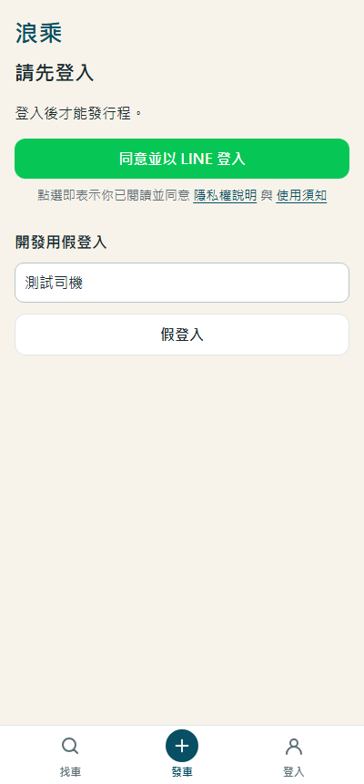

### TC-CONTACT-01

**沒填聯絡方式時發行程要先填** — ✅ 通過

- **期望**：先出現「先填聯絡方式」表單，不是發車表單；儲存後出現發車表單

截圖（司機阿凱 的畫面）：


### TC-TRIP-09

**第一次發車表單全空** — ✅ 通過

- **期望**：沒有「已帶入」提示，所有欄位空白、浪點都沒勾

截圖（司機阿凱 的畫面）：


### TC-TRIP-07

**發車頁提示車資以分攤為原則** — ✅ 通過

- **期望**：單程車資欄位下方顯示「共乘車資以分攤油資與過路費為原則，請勿以載客營利為業」

截圖（司機阿凱 的畫面）：

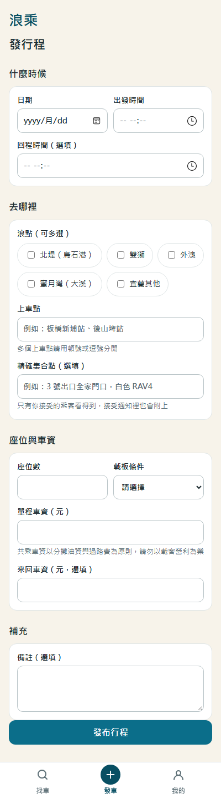

### TC-TRIP-03

**漏填必填欄位無法發布並標示欄位** — ✅ 通過

- **期望**：停在發車頁，頁首紅色訊息列出缺少的欄位（浪點、上車點、座位數、載板條件、單程車資），對應欄位被標示；行程未建立

截圖（司機阿凱 的畫面）：

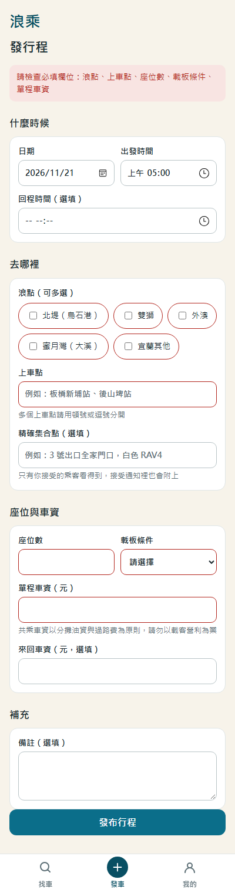

### TC-TRIP-04

**出發時間已過無法發布** — ✅ 通過

- **期望**：停在發車頁，顯示「出發時間必須晚於現在」，日期與出發時間欄位被標示

截圖（司機阿凱 的畫面）：

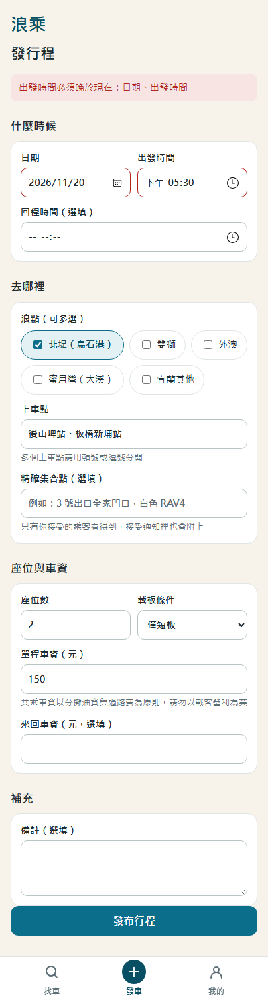

### TC-TRIP-01

**司機發布含必填與選填欄位的行程** — ✅ 通過

- **期望**：導向新行程頁，顯示浪點「北堤、雙獅」、上車點兩個、座位「共 2 位，剩 2 位」、載板「僅短板」、車資「單程 $150／來回 $250」、回程 10:00
- **備註**：依案例同時填單程 150、來回 250。單程是必填、來回是選填，這是規格行為，不是 bug。

截圖（司機阿凱 的畫面）：

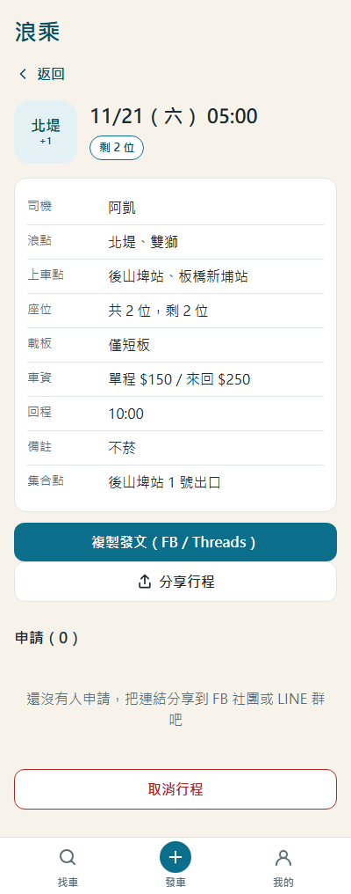

### TC-TRIP-08

**第二趟發車帶入上一趟資料，日期空白** — ✅ 通過

- **期望**：表單上方顯示「已帶入你上一趟的資料，記得選日期」；出發時間、回程時間、浪點勾選、上車點、精確集合點、座位、載板、單程與來回車資、備註都和上一趟相同；**日期欄位是空的**

截圖（司機阿凱 的畫面）：

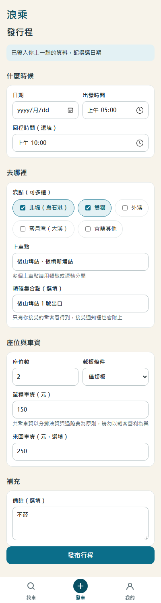

### TC-TRIP-05

**未登入用分享連結查看行程** — ✅ 通過

- **期望**：看得到日期、時間、浪點、上車點、座位、載板、車資；申請區顯示「同意並以 LINE 登入」，旁邊有隱私權說明與使用須知連結

截圖（訪客（未登入） 的畫面）：

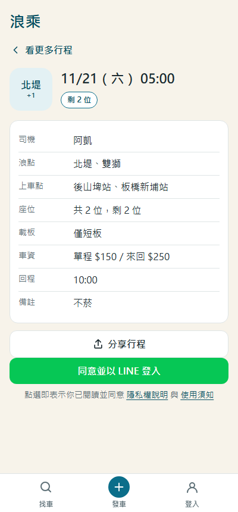

### TC-TRIP-06

**開啟不存在的行程連結** — ✅ 通過

- **期望**：顯示「找不到資料」的錯誤訊息，畫面沒有壞掉，可回首頁

截圖（訪客（未登入） 的畫面）：

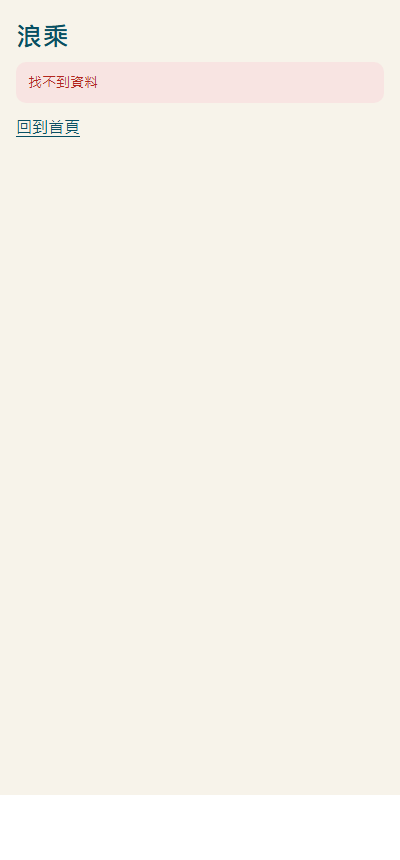

### TC-MEET-01

**司機填集合點，自己看得到** — ✅ 通過

- **期望**：行程詳細資料出現「集合點：後山埤站 1 號出口，白色 RAV4」

截圖（司機阿凱 的畫面）：

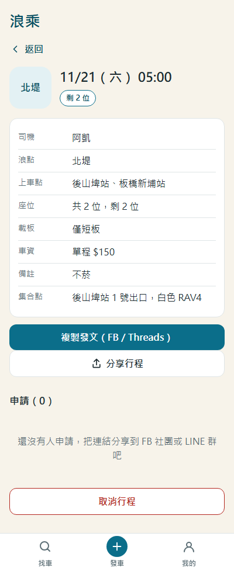

### TC-SHARE-05

**發文文字不含私人資訊且只有一個標籤** — ✅ 通過

- **期望**：內容沒有 `akai-line`、沒有集合點文字、沒有備註；整段只有一個「#」

貼上的發文文字：

```text
#我是司機徵乘客
日期：11/21（六）
浪點：北堤
出發：05:00
上車：後山埤站、板橋新埔站
座位：剩 2 位
載板：僅短板
車資：單程 $150

申請共乘：http://localhost:3011/trips/2
```

截圖（司機阿凱 的畫面）：

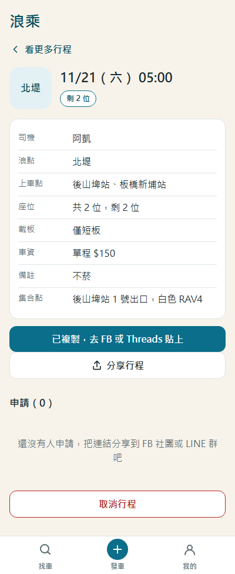

### TC-MEET-02

**不填集合點也能發布** — ✅ 通過

- **期望**：發布成功，行程頁沒有「集合點」這一列

截圖（司機阿凱 的畫面）：

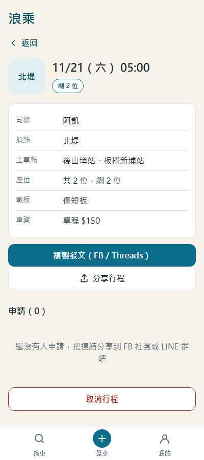

### TC-TRIP-10

**上一趟已取消仍會帶入** — ✅ 通過

- **期望**：帶入的是那趟已取消行程的資料（單程車資 180），日期空白

截圖（司機阿凱 的畫面）：

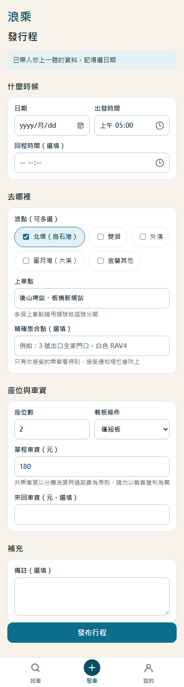

### TC-FIND-08

**首頁預設明天，一鍵切到全部日期** — ✅ 通過

- **期望**：一開始選中的是明天，只顯示明天那趟；點「全部」後兩趟都顯示
- **備註**：資料：明天兩趟（05:00、07:00）＋後天一趟，比案例前置多一趟，不影響判定。

截圖（訪客（未登入） 的畫面）：

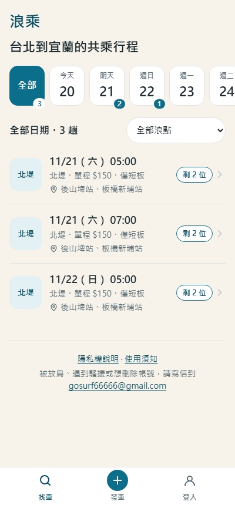

### TC-FIND-01

**全部日期列表由近到遠排序** — ✅ 通過

- **期望**：列表依序為明天 05:00、明天 07:00、後天 05:00；摘要顯示「全部日期・3 趟」

截圖（訪客（未登入） 的畫面）：


### TC-FIND-03

**依日期篩選** — ✅ 通過

- **期望**：只顯示後天 05:00 那一趟，列中只顯示「05:00 出發」不重複日期

截圖（訪客（未登入） 的畫面）：

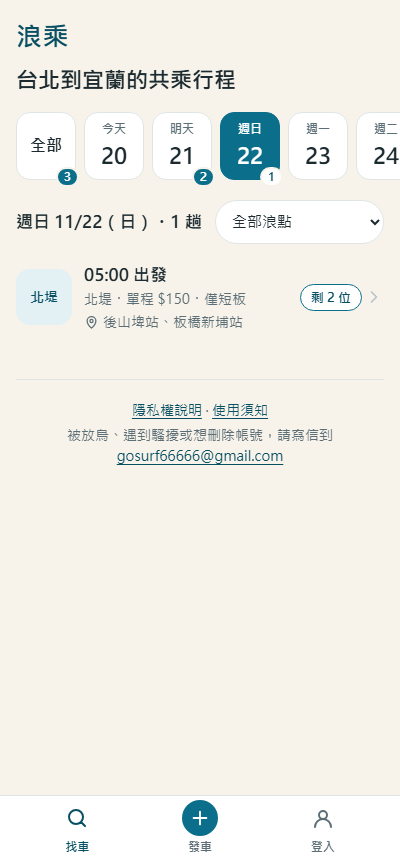

### TC-FIND-04

**選沒有行程的日期** — ✅ 通過

- **期望**：顯示「目前沒有符合的行程，換個日期或浪點看看」，摘要「…・0 趟」

截圖（訪客（未登入） 的畫面）：

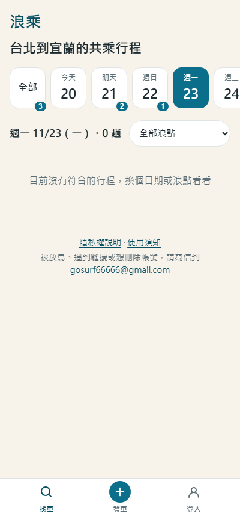

### TC-FIND-02

**已取消的行程不出現在列表** — ✅ 通過

- **期望**：只剩明天 05:00 與後天 05:00 兩趟，摘要「全部日期・2 趟」

截圖（訪客（未登入） 的畫面）：

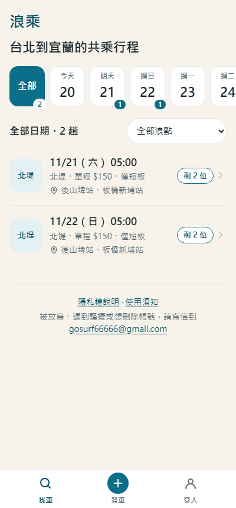

### TC-FIND-05

**依浪點篩選，多浪點行程也會出現** — ✅ 通過

- **期望**：只顯示 B；B 列左側方塊顯示「北堤 +1」，說明文字列出「北堤、蜜月灣」；浪點選單裡沒有「烏石港」「頭城」

截圖（訪客（未登入） 的畫面）：

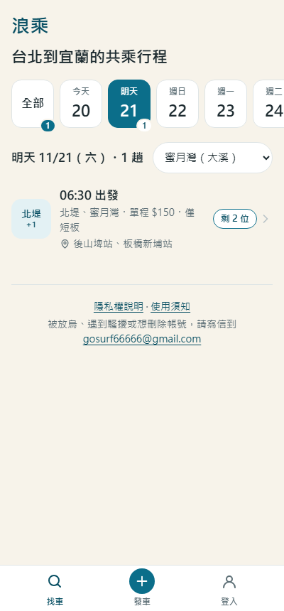

### TC-FIND-06

**選沒有車的浪點** — ✅ 通過

- **期望**：顯示「目前沒有符合的行程，換個日期或浪點看看」

截圖（訪客（未登入） 的畫面）：

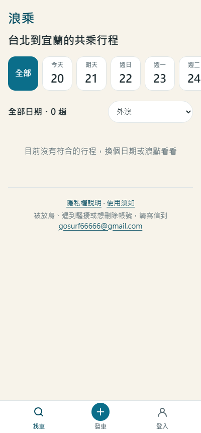

### TC-FIND-09

**明天沒有行程時提示並提供切換** — ✅ 通過

- **期望**：先顯示「明天目前沒有行程」與「看全部日期」按鈕；點下去後顯示後天那趟

截圖（訪客（未登入） 的畫面）：

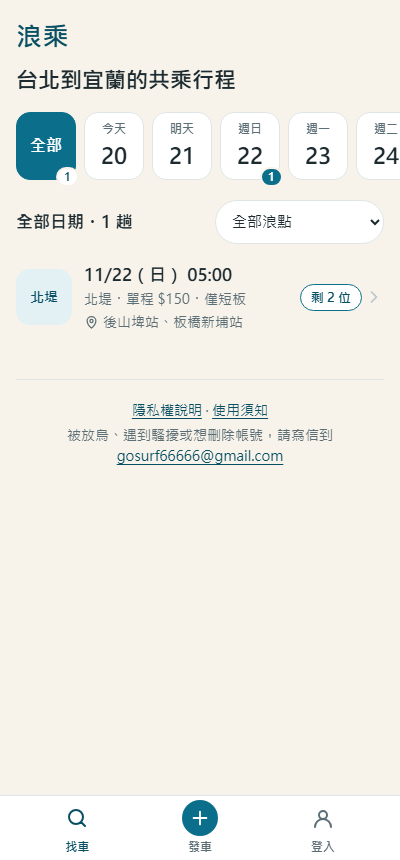

### TC-REQ-02

**沒選上車點或板型無法申請** — ✅ 通過

- **期望**：顯示紅色訊息列出上車點、浪板類型，兩個欄位被標示；沒有建立申請

截圖（乘客小魚 的畫面）：


### TC-REQ-12

**僅短板行程可以帶短板（選單部分）** — ✅ 通過

- **期望**：選單只有「不帶板」「短板」兩項（沒有長板）；申請成功

截圖（乘客小魚 的畫面）：

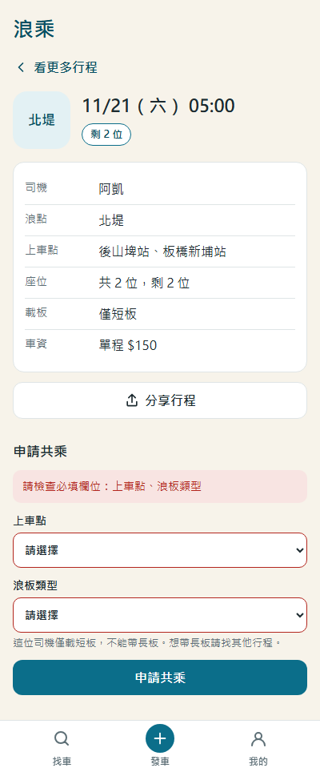

### TC-REQ-01

**乘客申請行程** — ✅ 通過

- **期望**：申請區變成小魚的申請卡，顯示「上車：後山埤站｜短板」與「待確認」

截圖（乘客小魚 的畫面）：


### TC-REQ-11

**不能重複申請同一行程** — ✅ 通過

- **期望**：只看到自己既有的申請卡（待確認），沒有第二個申請表單

截圖（乘客小魚 的畫面）：


### TC-CANCEL-03

**乘客看不到取消行程按鈕** — ✅ 通過

- **期望**：頁面上沒有「取消行程」按鈕

截圖（乘客小魚 的畫面）：

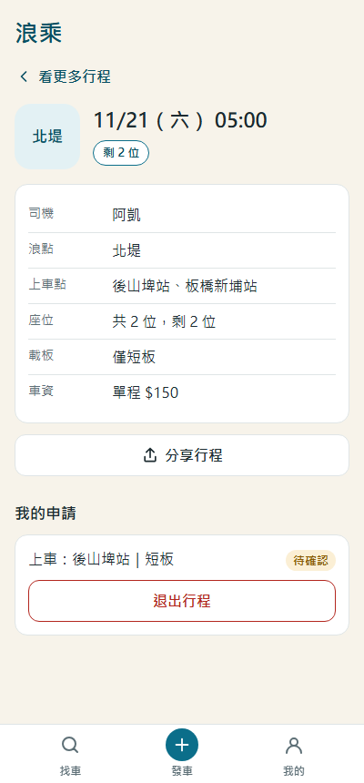

### TC-REQ-10

**司機不能申請自己的行程** — ✅ 通過

- **期望**：看到「申請（N）」清單與「取消行程」，沒有申請表單

截圖（司機阿凱 的畫面）：

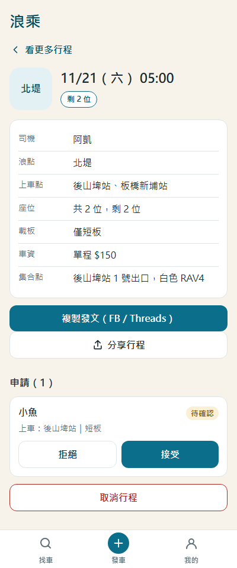

### TC-REQ-06

**乘客看不到別人行程的申請清單** — ✅ 通過

- **期望**：沒有「申請（N）」清單，看不到小魚的名字與任何接受／拒絕按鈕，只有小浪自己的申請表單

截圖（乘客小浪 的畫面）：

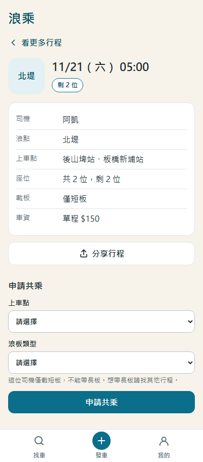

### TC-REQ-04

**司機看到申請並接受** — ✅ 通過

- **期望**：卡片顯示小魚的名字、「後山埤站｜短板」；按下後狀態變「已接受」，接受／拒絕按鈕消失

截圖（司機阿凱 的畫面）：

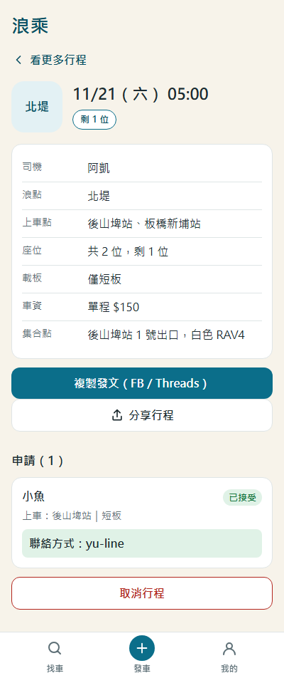

### TC-REQ-07

**接受後剩餘座位減一** — ✅ 通過

- **期望**：座位從「共 2 位，剩 2 位」變成「共 2 位，剩 1 位」；首頁列表的座位也同步

截圖（訪客（未登入） 的畫面）：

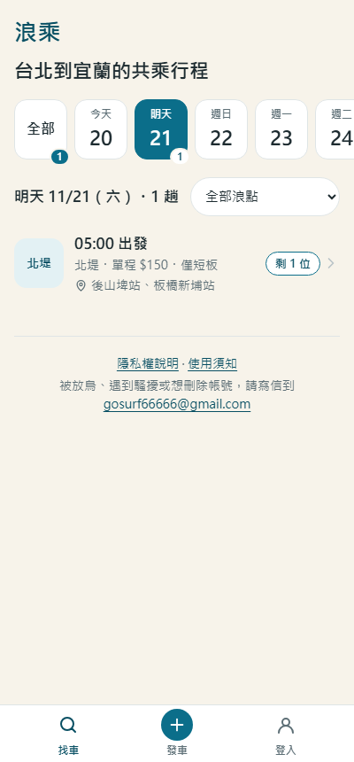

### TC-CONTACT-04

**接受後雙方看得到聯絡方式** — ✅ 通過

- **期望**：小魚的申請卡顯示「司機聯絡方式：akai-line」；阿凱在小魚的卡片上看到 `yu-line`

截圖（司機阿凱 的畫面）：


### TC-MEET-03

**被接受的乘客看得到集合點（頁面部分；推播看 log）** — ⚠️ 部分（推播需真 LINE）

- **期望**：推播內含「集合點：後山埤站 1 號出口，白色 RAV4」；行程頁也顯示集合點
- **備註**：頁面上看得到集合點；伺服器 log 的接受推播文字含「集合點：後山埤站 1 號出口，白色 RAV4」。手機實際收到推播仍需跑法 B。

截圖（乘客小魚 的畫面）：

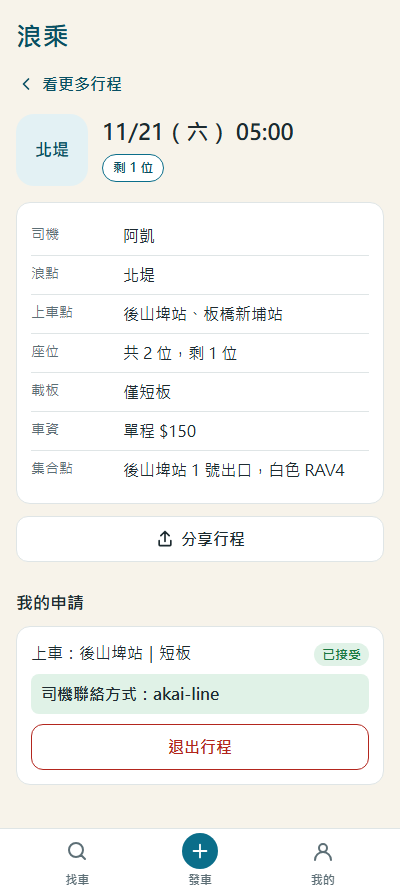

### TC-REQ-05

**司機拒絕申請** — ✅ 通過

- **期望**：小浪的卡片狀態變「已拒絕」；剩餘座位不變

截圖（司機阿凱 的畫面）：

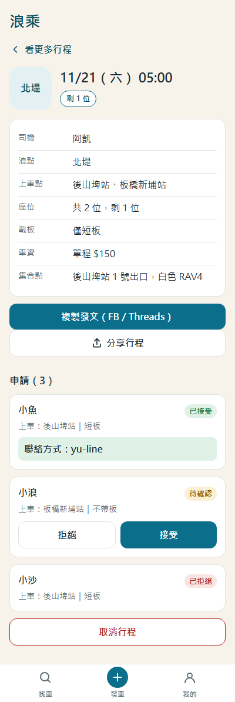

### TC-CONTACT-05

**未被接受者與訪客看不到聯絡方式** — ✅ 通過

- **期望**：三者都看不到 `akai-line`；阿凱在小浪、小沙的卡片上看不到他們的聯絡方式

截圖（司機阿凱 的畫面）：


### TC-MEET-04

**未被接受者與訪客看不到集合點** — ✅ 通過

- **期望**：三者的行程頁都沒有集合點；拒絕推播不含集合點文字

截圖（訪客（未登入） 的畫面）：

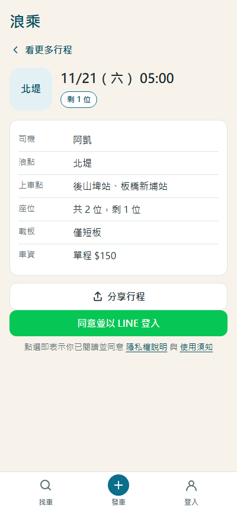

### TC-CANCEL-06

**已拒絕的申請沒有退出按鈕** — ✅ 通過

- **期望**：申請標示「已拒絕」，沒有「退出行程」按鈕

截圖（乘客小沙 的畫面）：

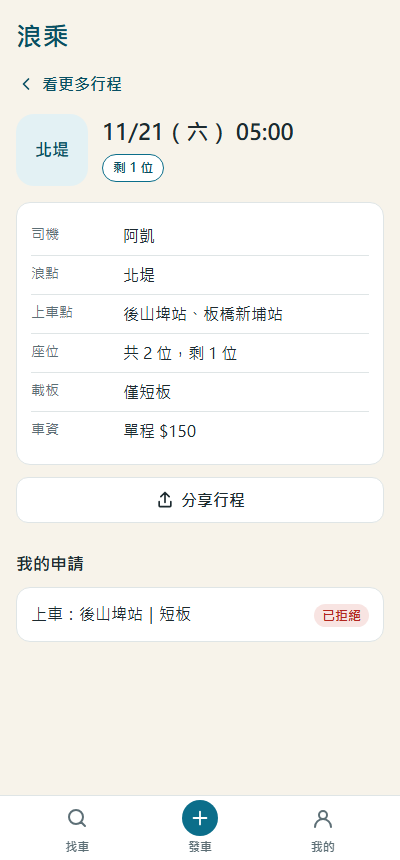

### TC-CONTACT-02

**沒填聯絡方式時申請要先填** — ✅ 通過

- **期望**：申請區先出現聯絡方式表單，填完儲存後才出現申請表單

截圖（新使用者小新 的畫面）：

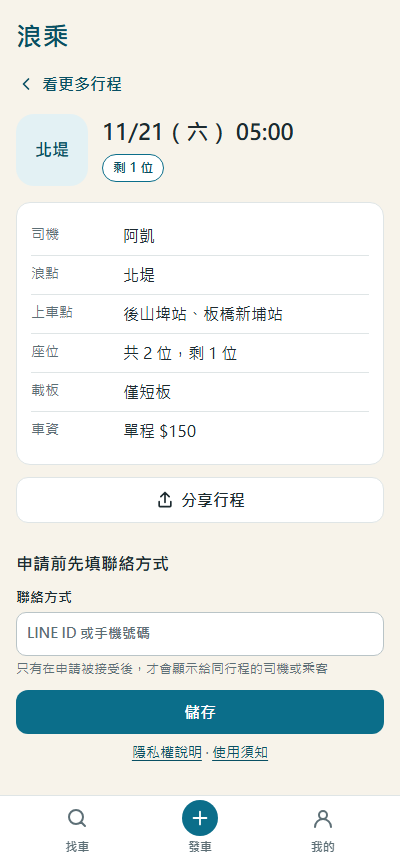

### TC-CONTACT-03

**聯絡方式留空無法儲存** — ✅ 通過

- **期望**：顯示「請填寫聯絡方式」，欄位被標示，仍停在聯絡方式表單
- **備註**：2026-11-19 首輪失敗（輸入框沒被標示、訊息重複成「請填寫聯絡方式：聯絡方式」），已修正 `public/app.js` 的 `contactForm` 與 `errorText` 後重跑通過。

截圖（新使用者小新 的畫面）：

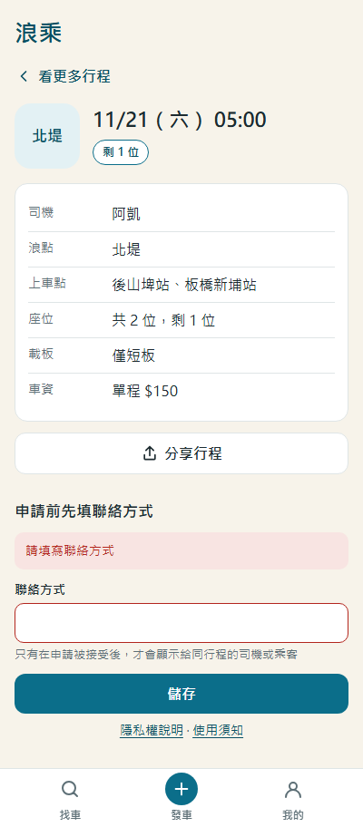

### TC-CONTACT-02b

**（接續）填完儲存後出現申請表單** — ✅ 通過

- **期望**：申請區先出現聯絡方式表單，填完儲存後才出現申請表單
- **備註**：補充：小新填好聯絡方式後出現申請表單（TC-CONTACT-02 的後半）。

截圖（新使用者小新 的畫面）：


### TC-CONTACT-06

**聯絡方式要是手機號碼或 LINE ID（格式錯誤被擋）** — ✅ 通過

- **期望**：步驟 1、2 顯示「聯絡方式格式不對，請填 LINE ID 或手機號碼」，欄位被標示，仍停在聯絡方式表單；步驟 3 儲存成功，出現申請表單

截圖（小石 的畫面）：

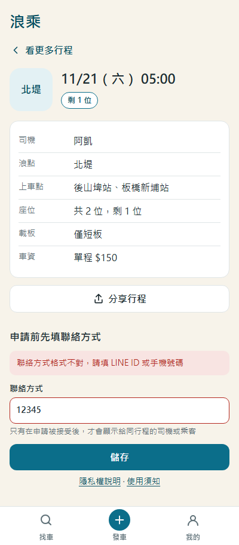

### TC-CONTACT-06b

**（接續）填手機號碼 0912-345-678 儲存成功** — ✅ 通過

- **期望**：步驟 1、2 顯示「聯絡方式格式不對，請填 LINE ID 或手機號碼」，欄位被標示，仍停在聯絡方式表單；步驟 3 儲存成功，出現申請表單
- **備註**：補充：TC-CONTACT-06 的步驟 3，合法手機號碼儲存後出現申請表單。

截圖（小石 的畫面）：


### TC-REQ-08

**坐滿後接受第二筆被擋** — ✅ 通過

- **期望**：第二次被擋下，頁首顯示「座位已滿」，小浪仍為「待確認」；已確認人數維持 1

截圖（司機阿凱 的畫面）：

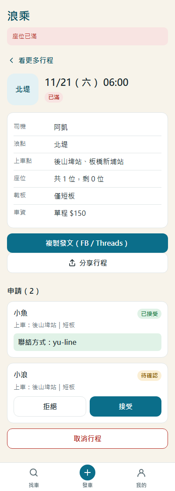

### TC-FIND-07

**坐滿的行程標示已滿且不能申請** — ✅ 通過

- **期望**：列表上該行程標示「已滿」；行程頁顯示「這個行程已滿，無法申請」，沒有申請表單

截圖（乘客小沙 的畫面）：

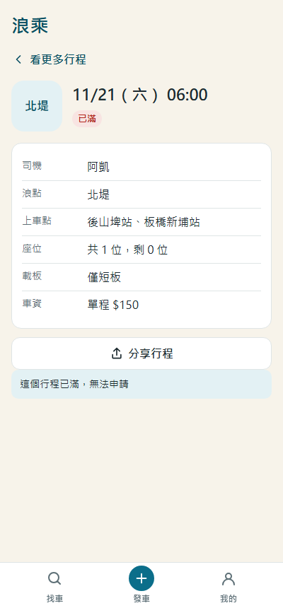

### TC-REQ-09

**乘客在「我的」看到申請狀態** — ✅ 通過

- **期望**：三筆申請都看得到，分別標示「待確認」「已接受」「已拒絕」

截圖（乘客小魚 的畫面）：

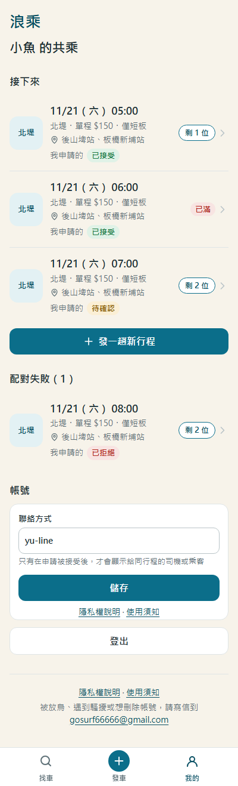

### TC-REQ-13

**不載板行程不能選短板或長板** — ✅ 通過

- **期望**：選單只有「不帶板」一項，並有說明文字提示司機不載板

截圖（乘客小魚 的畫面）：

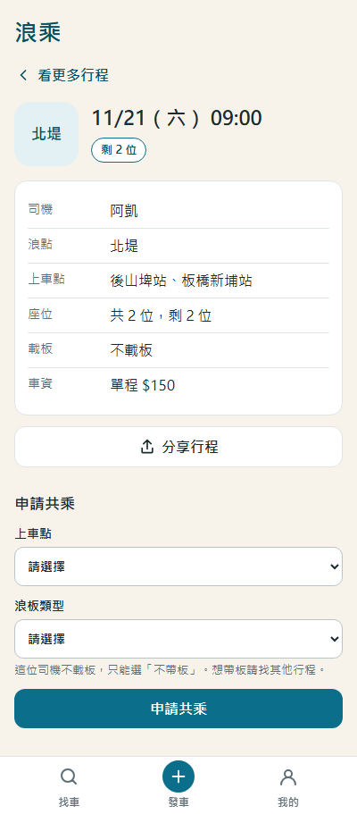

### TC-REQ-12b

**僅短板行程申請短板成功** — ✅ 通過

- **期望**：選單只有「不帶板」「短板」兩項（沒有長板）；申請成功
- **備註**：補充：小浪以短板申請 T3 成功（TC-REQ-12 的「申請成功」部分）。

截圖（乘客小浪 的畫面）：

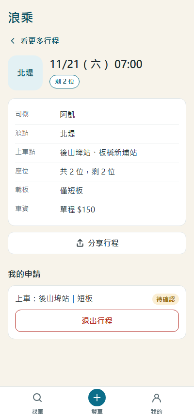

### TC-CANCEL-04

**已接受的乘客退出，座位釋放（頁面＋log）** — ⚠️ 部分（推播需真 LINE）

- **期望**：小魚的申請消失、重新出現申請表單；座位回到「剩 2 位」；阿凱收到小魚退出的推播
- **備註**：申請卡消失、重新出現申請表單、座位回到剩 2 位；log 有「小魚 退出了你…」推播。手機實際收到推播仍需跑法 B。

截圖（司機阿凱 的畫面）：

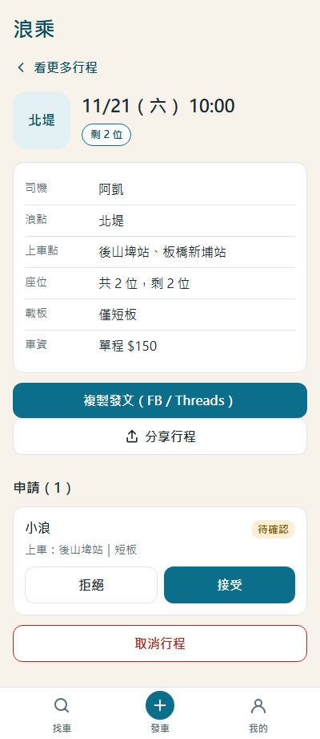

### TC-CANCEL-05

**待確認的乘客退出，司機不收推播（頁面＋log）** — ⚠️ 部分（推播需真 LINE）

- **期望**：阿凱的申請清單不再有小浪；阿凱**沒有**收到推播；座位不變
- **備註**：阿凱清單不再有小浪、座位不變；log 沒有退出推播。手機端確認仍需跑法 B。

截圖（司機阿凱 的畫面）：

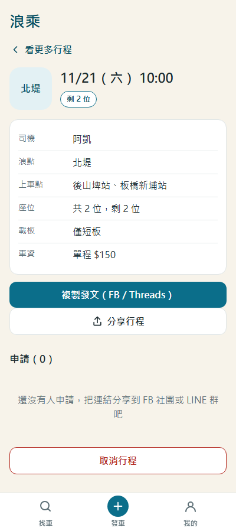

### TC-CANCEL-01

**司機取消行程（頁面＋log；手機推播要另測）** — ⚠️ 部分（推播需真 LINE）

- **期望**：行程頁標示「已取消」、取消按鈕消失；小魚與小浪都收到「…行程已被司機取消」推播；首頁列表不再出現該行程
- **備註**：行程頁標示已取消、取消按鈕消失、首頁不再列出；log 有 2 則「已被司機取消」推播（已接受＋待確認各一）。手機實際收到推播仍需跑法 B。

截圖（訪客（未登入） 的畫面）：

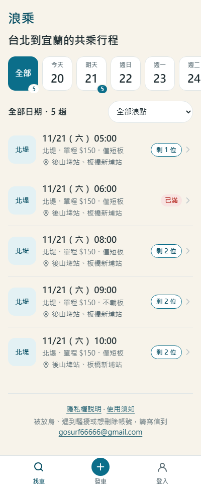

### TC-CANCEL-02

**已取消的行程不能申請** — ✅ 通過

- **期望**：顯示「已取消」標示，沒有申請表單

截圖（乘客小沙 的畫面）：

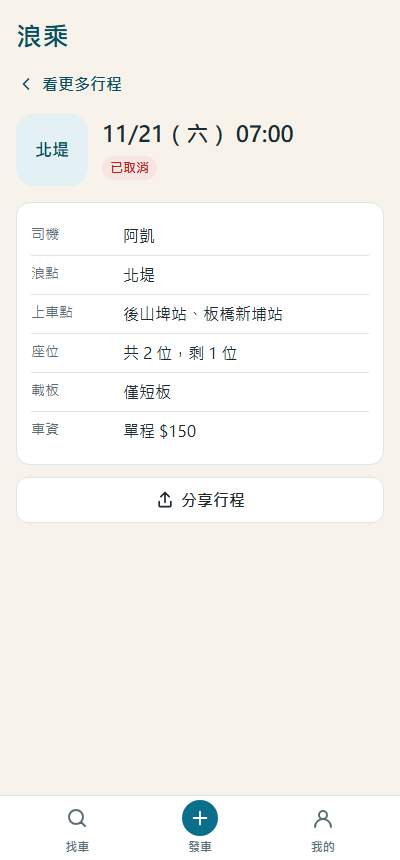

### TC-METRIC-01

**成行的行程計入每週統計** — ✅ 通過

- **期望**：該行程所在的週次趟數比執行前多 1
- **做法**：出發時間改成 3 分鐘後（代替 10 分鐘）。三趟同時出發：一趟接受小魚、一趟沒乘客、一趟接受後取消。

```text
$ npm run stats   # 出發前
目前沒有成行紀錄
$ npm run stats   # 出發後
2026-11-16 當週：1 趟
```

### TC-METRIC-02

**沒有乘客或已取消的行程不計入** — ✅ 通過

- **期望**：這兩趟都沒有計入（只有 TC-METRIC-01 那趟讓週次 +1）
- **做法**：出發時間改成 3 分鐘後（代替 10 分鐘）。三趟同時出發：一趟接受小魚、一趟沒乘客、一趟接受後取消。

```text
$ npm run stats   # 出發前
目前沒有成行紀錄
$ npm run stats   # 出發後
2026-11-16 當週：1 趟
```
